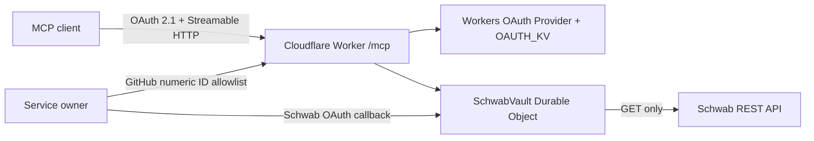

# Schwab Read-only MCP on Cloudflare Workers

这是一个单用户、只读的远程 MCP。它把 Charles Schwab Trader API 的生产 REST 行情和账户查询能力暴露为 Streamable HTTP MCP，并部署在 Cloudflare Workers。MCP 客户端通过 Worker 自己签发的 OAuth 令牌访问 `/mcp`；GitHub OAuth 只用于确认服务拥有者身份，Schwab OAuth 凭据只保存在 SQLite-backed Durable Object 中。

## 只读边界

初版包含 14 个工具：

- `schwab_connection_status`
- `get_quotes`
- `get_price_history`
- `get_option_chain`
- `get_option_expiration_chain`
- `get_market_hours`
- `get_movers`
- `search_instruments`
- `list_accounts`
- `get_account`
- `get_orders`
- `get_order`
- `get_transactions`
- `get_user_preferences`

Schwab 数据客户端只允许 `GET`。代码没有下单、改单、撤单、Streamer 或行情缓存。OAuth token endpoint 必须使用 `POST`，它不属于交易数据客户端。账户工具只接受并返回 Schwab `hashValue`；完整账号和凭据会在 MCP 输出及结构化日志前移除。

## 运行结构



每个 MCP 请求创建新的 `McpServer`。Schwab token、到期时间和一次性 OAuth state 放在单个 `SchwabVault` Durable Object 中。对象会合并并发 refresh、在 access token 到期前五分钟刷新、在 401 后强制刷新并重试一次。刷新不会延长首次 Schwab 授权起算的七天期限。429 和 5xx 最多重试一次；若 `Retry-After` 超过两秒，则不提前重试，而是返回包含 `retryAfterMs` 的明确错误。`invalid_grant` 会立即转为 `REAUTHORIZATION_REQUIRED`。

## 本地配置

需要 Node.js 20 或更新版本。

```bash
npm install
cp .dev.vars.example .dev.vars
```

编辑 `wrangler.jsonc`：

1. 把 `GITHUB_CLIENT_ID` 换成 GitHub OAuth App 的 Client ID。
2. 把 `ALLOWED_GITHUB_USER_ID` 换成你不可变的 GitHub numeric user ID。
3. 把 `SCHWAB_REDIRECT_URI` 换成固定生产回调地址：`https://schwab-mcp.<account-subdomain>.workers.dev/auth/schwab/callback`。
4. 创建 KV namespace，然后把返回的 ID 写入 `OAUTH_KV`：

```bash
npx wrangler kv namespace create OAUTH_KV
```

本地秘密只放在 `.dev.vars`：`GITHUB_CLIENT_SECRET`、`SCHWAB_CLIENT_ID`、`SCHWAB_CLIENT_SECRET`。`.dev.vars` 已被 Git 忽略。

GitHub OAuth App 的 callback URL 必须是：

```text
https://schwab-mcp.<account-subdomain>.workers.dev/auth/github/callback
```

Schwab Production App 的 callback URL 必须和 `SCHWAB_REDIRECT_URI` 完全一致，包括协议、主机、路径和大小写。

## 验证

```bash
npm run types
npm run typecheck
npm run lint
npm test
```

测试使用 Vitest 和 Cloudflare Workers 测试池，覆盖 OAuth state 一次性消费和过期、GitHub numeric ID 白名单、令牌脱敏、并发 refresh 合并、refresh token 轮换、401/429/5xx 重试、`invalid_grant` 重新授权、输入 schema 和 Schwab 数据客户端的 GET-only 静态检查。

## 部署

先把生产秘密写入 Cloudflare：

```bash
npx wrangler secret put GITHUB_CLIENT_SECRET
npx wrangler secret put SCHWAB_CLIENT_ID
npx wrangler secret put SCHWAB_CLIENT_SECRET
npm run deploy
```

部署后访问以下地址完成 Schwab 授权：

```text
https://schwab-mcp.<account-subdomain>.workers.dev/auth/schwab/connect
```

远程 MCP 地址是：

```text
https://schwab-mcp.<account-subdomain>.workers.dev/mcp
```

`/health` 只返回运行状态和版本，不返回 Schwab 连接状态或账户数据。

## 日志与排错

Workers structured logs 记录：

- `event`
- `requestId`
- `tool`
- `status`
- `attempts`
- `durationMs`

主要事件为 `schwab_api_request`、`schwab_token_refresh`、`schwab_response_invalid`、`github_oauth_failed`、`schwab_oauth_failed` 和 `mcp_handler_error`。日志不记录请求头、OAuth code、access token、refresh token或完整账号。查看生产日志：

```bash
npx wrangler tail schwab-mcp --format json
```

错误通过 MCP `isError: true` 返回稳定错误码：`AUTH_REQUIRED`、`REAUTHORIZATION_REQUIRED`、`INVALID_ARGUMENT`、`RATE_LIMITED`、`SCHWAB_REJECTED`、`UPSTREAM_UNAVAILABLE`。上游错误不会转换为空结果。
