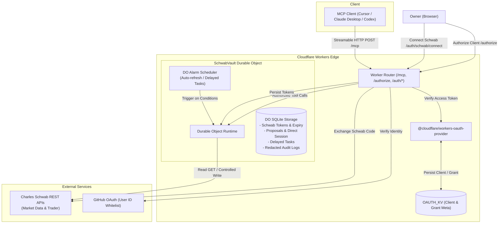

# Schwab MCP on Cloudflare Workers

English | [简体中文](README.zh-CN.md)

[](https://www.typescriptlang.org/)
[](https://workers.cloudflare.com/)
[](https://modelcontextprotocol.io/)
[](https://vitest.dev/)
[](LICENSE)

> [!CAUTION]
> **Disclaimer**  
> This project is for educational, research, and experimental automation purposes only. **It does NOT constitute financial advice or investment recommendations.** Trading securities and options carries substantial risk of loss. Authors and contributors assume no liability for any trading actions, losses, API errors, network latency, or LLM hallucinations.

A production-grade, single-user remote **Model Context Protocol (MCP)** server running on **Cloudflare Workers**. It exposes Charles Schwab market data and account services to LLM clients (Cursor, Claude Desktop, VS Code) via **Streamable HTTP** (`/mcp`) with strict zero-trust security and anti-hallucination guardrails.

---

## Key Highlights

- **Zero-Trust Access**: OAuth 2.1 dynamic client registration gated by an immutable GitHub Numeric User ID whitelist.
- **Granular Client Scopes**: Each MCP client independently chooses `read_only` (default, trading tools hidden) or `full_access`.
- **Physical Credential Isolation**: Schwab tokens, state machines, and audit logs reside strictly within an SQLite-backed Durable Object (`SchwabVault`). Secrets never leak into KV or logs.
- **Anti-Hallucination Guardrails**:
  - Global killswitch (`ENABLE_TRADING`) defaults to `false`.
  - Mandatory **two-phase confirmation** with verbatim phrase repetition for immediate and modified orders.
  - Optional ephemeral **session direct trading** (30-min idle timeout, 8-hour cap, single-reveal token).
  - Deterministic **delayed conditional orders** executed via Durable Object Alarms.
  - Zero blind write retries on network failures (`EXECUTION_UNCERTAIN`).

---

## Architecture



## Why Cloudflare Workers? (Comparison)

| Feature | Typical Local MCP (Python/stdio) | **schwab-mcp (This Project)** |
| :--- | :--- | :--- |
| **Runtime & Deployment** | Local machine process (dies on sleep/shutdown) | **Cloudflare Workers Edge (24/7 Global Serverless)** |
| **Multi-Client Access** | Single desktop only | **Remote Streamable HTTP (`/mcp`) across Cursor, Claude, VS Code & mobile** |
| **Credential Storage** | Plaintext files on local disk | **Isolated SQLite inside Durable Object (`SchwabVault`), zero KV/log leaks** |
| **Client Permissions** | All tools exposed unconditionally | **Dynamic OAuth Scope (`read_only` vs `full_access`) per client** |
| **Trading Safety** | None or weak prompt-based hints | **Deployment killswitch (`ENABLE_TRADING`), two-phase phrase repetition, session capability** |
| **Off-hours / Conditional Orders** | Impossible if computer sleeps | **Durable Object Alarms trigger deterministic conditional orders in the cloud** |
| **Network Failure Safety** | Risk of double-execution on blind retry | **`EXECUTION_UNCERTAIN` state blocks blind re-submissions** |

---

## Example Agent Workflows

### 1. Portfolio Analysis & Option Chain (Read-Only)

> **User**: *"What's my current position in NVDA, and what does the next monthly 140 CALL option look like?"*  
> **Agent**: *(Calls `get_account` and `get_option_chain`)*  
> *"You hold 100 shares of NVDA at an average price of $118.40 (unrealized P&L: +18.2%). The 30-day $140 CALL is currently trading at $4.20 bid / $4.35 ask, with Delta 0.38 and IV of 42.1%."*

### 2. Guarded Order Execution (Two-Phase Confirmation)

> **User**: *"Buy 10 shares of AAPL with a limit order at $220.00."*  
> **Agent**: *(Calls `prepare_trade` with action `PLACE` to freeze order snapshot)*  
> *"I have prepared and frozen the order snapshot:*  
> *- **Action**: BUY 10 AAPL @ Limit $220.00 (Day)*  
> *- **Account**: `...8a9f`*  
> *- **Proposal ID**: `prop_01JABC...` (Valid for 5 minutes)*  
> *⚠️ **To confirm and execute, please reply verbatim with:**  
> `CONFIRM BUY 10 AAPL LIMIT 220.00 HASH 8a9f`"*  
>  
> **User**: `CONFIRM BUY 10 AAPL LIMIT 220.00 HASH 8a9f`  
> **Agent**: *(Calls `confirm_trade` consuming one-time token with verbatim phrase)*  
> *"Order successfully placed with Charles Schwab. Order ID: `#10098234`."*

---
---

## MCP Tools Catalog

The server registers **24 MCP tools**. Schema validation strictly follows Zod definitions in [`src/schemas.ts`](src/schemas.ts).

### Read-Only & Diagnostics (15 Tools)

Available to all authenticated clients. Operations use HTTP `GET`:

| Tool | Description | Key Inputs |
| :--- | :--- | :--- |
| `schwab_connection_status` | Check Schwab OAuth connection and expiration | None |
| `get_trading_diagnostics` | Check tool registration, killswitch, and active trading status | None (always visible) |
| `get_quotes` | Fetch real-time market quotes | `symbols` (1–50 array), `fields`, `indicative` |
| `get_price_history` | Historical OHLCV candle bars | `symbol`, `periodType`, `frequencyType`, `frequency`, `startDate`, `endDate` |
| `get_option_chain` | Option chains, Greeks, and quotes | `symbol`, `contractType` (`CALL`/`PUT`/`ALL`), `strikeCount`, `strategy` |
| `get_option_expiration_chain` | Expiration dates for option underlying | `symbol` |
| `get_market_hours` | Market trading schedules | `markets` (`equity`, `option`, `bond`, etc.), `date` (`YYYY-MM-DD`) |
| `get_movers` | Market gainers/losers/actives | `index` (`$DJI`, `$COMPX`, `$SPX`), `sort`, `frequency` |
| `search_instruments` | Search tickers or fundamental definitions | `symbol`, `projection` |
| `list_accounts` | List account hash identifiers (real numbers stripped) | None |
| `get_account` | Balances and positions for an account hash | `accountHash`, `includePositions` |
| `get_orders` | Execution history across accounts | `fromEnteredTime`, `toEnteredTime` (ISO-8601), `status` |
| `get_order` | Execution details for a specific order | `accountHash`, `orderId` |
| `get_transactions` | Account cash flow and trade transactions | `accountHash`, `startDate`, `endDate` (`YYYY-MM-DD`), `types`, `symbol` |
| `get_user_preferences` | User profile context and trade permissions | None |

### Trading Control Tools (9 Tools)

> [!WARNING]
> Only registered for clients granted **`full_access`** during OAuth authorization. Executing trades additionally requires `ENABLE_TRADING=true`. Cancellation remains available even when trading is disabled to de-risk positions.

| Tool | Description | Key Inputs |
| :--- | :--- | :--- |
| `enable_trading` | Read-only check for deployment killswitch status | None (switch cannot be toggled via MCP) |
| `prepare_trade` | Freeze order snapshot and issue 5-minute single-use token | `accountHash`, `action` (`PLACE`/`REPLACE`), `executionMode`, `orderPayload`, `userInstruction` |
| `confirm_trade` | Consume confirmation token with verbatim text playback | `proposalId`, `confirmationToken`, `confirmationText` |
| `enable_session_direct_trading` | Enable direct order placement for the current session | `userInstruction` (returns single-reveal `sessionCapability`) |
| `place_order_direct` | Direct order submission bypassing per-order confirmation | `sessionCapability`, `executionKey` (UUID), `accountHash`, `orderPayload`, `userInstruction` |
| `disable_session_direct_trading` | Invalidate active direct trading capability immediately | `sessionCapability` |
| `cancel_order` | Cancel working market order (no confirmation needed) | `accountHash`, `orderId`, `userInstruction` |
| `list_delayed_trades` | List active and historical conditional orders | `status` (`ACTIVE`, `EXECUTING`, `EXECUTED`, etc.) |
| `cancel_delayed_trade` | Cancel an active conditional task immediately | `taskId`, `userInstruction` |

---

## Safety & Security Guardrails

1. **Deployment Killswitch (`ENABLE_TRADING`)**:
   - Configured in `wrangler.jsonc` (default: `"false"`).
   - When `false`, order preparations, confirmations, and session capability grants fail closed. Working orders can still be cancelled.
2. **Anti-Hallucination Two-Phase Confirmation**:
   - `prepare_trade` generates an immutable snapshot and a random confirmation sentence.
   - The user must explicitly repeat the confirmation sentence before `confirm_trade` consumes the token and executes the order.
3. **Session Direct Trading Mode**:
   - Limited strictly to `IMMEDIATE` + `PLACE` (order modifications still require confirmation).
   - 30-minute idle expiry, refreshed on use; 8-hour hard lifetime.
   - Atomic idempotent claim using client-provided `executionKey`.
4. **Deterministic Delayed Orders**:
   - AST-based rules combining `TIME` and `QUOTE` thresholds. Monitored by Durable Object Alarms.
5. **No Blind Retries on Write (`EXECUTION_UNCERTAIN`)**:
   - Network errors or upstream 5xx on write requests mark the order as `EXECUTION_UNCERTAIN`. Blind retries are blocked; inspect status manually with `get_orders`.
6. **Payload Sanitization**:
   - Max 64 KiB UTF-8 JSON, max depth of 16, max 2048 nodes. Real account numbers and sensitive tokens are strictly scrubbed.

---

## Quickstart

### Prerequisites

- **Node.js**: >= 20.0.0 (LTS recommended)
- **Cloudflare Account**: Workers & Durable Objects enabled
- **GitHub Account**: OAuth App created for owner authentication
- **Charles Schwab Developer Account**: Approved developer app with Trader & Market Data APIs

### Local Setup

1. Install dependencies:
   ```bash
   npm install
   ```

2. Configure local development variables:
   ```bash
   cp .dev.vars.example .dev.vars
   ```
   Fill in `.dev.vars` (ignored by git):
   ```ini
   GITHUB_CLIENT_SECRET="your_github_client_secret"
   SCHWAB_CLIENT_ID="your_schwab_app_key"
   SCHWAB_CLIENT_SECRET="your_schwab_app_secret"
   ```

3. Update `wrangler.jsonc`:
   - Set `GITHUB_CLIENT_ID` and `ALLOWED_GITHUB_USER_ID` (find via `curl -s https://api.github.com/users/<username> | grep '"id":'`).
   - Set `SCHWAB_REDIRECT_URI` to `https://<worker-name>.<subdomain>.workers.dev/auth/schwab/callback`.
   - Keep `ENABLE_TRADING="false"` during development.

4. Run automated validation:
   ```bash
   npm run validate
   ```
   *(Runs typecheck, lint, and Vitest suite under simulated Workers DO environments).*

---

## Production Deployment

### Step 1: Create KV & Set Secrets

```bash
# 1. Create KV namespace for OAuth client/token persistence
npx wrangler kv namespace create OAUTH_KV
# Put the returned id into wrangler.jsonc under kv_namespaces

# 2. Upload secrets interactively
npx wrangler secret put GITHUB_CLIENT_SECRET
npx wrangler secret put SCHWAB_CLIENT_ID
npx wrangler secret put SCHWAB_CLIENT_SECRET
```

### Step 2: Deploy Worker

```bash
npm run deploy
```

> [!NOTE]
> MCP authorization uses `AUTHORIZATION_VERSION = "client-permissions-v1"`. Updating this version invalidates active grants, requiring clients to re-authenticate and pick permissions. Schwab account bindings and pending delayed trades remain intact.

### Step 3: CI/CD Pipeline (GitHub Actions)

The repository includes [`.github/workflows/deploy.yml`](.github/workflows/deploy.yml) for automated builds on `main`:
- **Repository Secrets**: `CLOUDFLARE_ACCOUNT_ID`, `CLOUDFLARE_API_TOKEN`
- **Repository Variables**: `PROD_OAUTH_KV_ID`, `PROD_ALLOWED_GITHUB_USER_ID`, `PROD_GITHUB_CLIENT_ID`, `PROD_SCHWAB_REDIRECT_URI`, `PROD_ENABLE_TRADING` (`false` by default)

Run `npm run configure:deploy` in CI to generate the deployment `wrangler.jsonc`. **Never put Schwab or GitHub client secrets in GitHub Actions!**

### Step 4: Authorize Charles Schwab

Visit in your browser:
```text
https://<your-worker-domain>/auth/schwab/connect
```
1. Authenticate with GitHub (must match `ALLOWED_GITHUB_USER_ID`).
2. Log in to Schwab and approve account access.
3. Tokens are securely encrypted into `SchwabVault` Durable Object.

---

## Client Configuration

MCP Endpoint: `https://<your-worker-domain>/mcp`

### Claude Desktop

Add to `claude_desktop_config.json`:
```json
{
  "mcpServers": {
    "schwab": {
      "url": "https://<your-worker-domain>/mcp"
    }
  }
}
```

### Cursor / VS Code / Codex

Configure as a remote MCP server:
- **Type**: `Streamable HTTP`
- **URL**: `https://<your-worker-domain>/mcp`
- On first connection, complete the browser OAuth flow, select **Read only** or **Full access**, and verify via GitHub.

---

## Error Codes & Operations

| Code | Cause | Action |
| :--- | :--- | :--- |
| `AUTH_REQUIRED` | Schwab account not linked | Visit `reconnectUrl` from response |
| `REAUTHORIZATION_REQUIRED` | Refresh token expired (7 days inactivity) | Visit `reconnectUrl` to re-authenticate |
| `INVALID_ARGUMENT` | Payload failed Zod validation | Review input against [`src/schemas.ts`](src/schemas.ts) |
| `RATE_LIMITED` | Schwab API rate limit reached (HTTP 429) | Back off following `retryAfterMs` |
| `SCHWAB_REJECTED` | Upstream business rejection | Check ticker, order status, or market hours |
| `UPSTREAM_UNAVAILABLE` | Schwab gateway or Durable Object error | Retry request (read requests retry once automatically) |
| `CONFIRMATION_INVALID` | Confirmation token mismatch or incorrect phrase | Re-run confirmation with exact text |
| `CONFIRMATION_EXPIRED` | Token exceeded 5-minute validity | Call `prepare_trade` again |
| `TRADE_STATE_CONFLICT` | Proposal already consumed or task cancelled | Refresh state with `list_delayed_trades` |
| `DIRECT_TRADING_SESSION_INVALID` | Session expired (30m idle / 8h max) | Call `enable_session_direct_trading` |
| `EXECUTION_UNCERTAIN` | Network failure during order submission | **Do not blindly retry.** Verify via `get_orders` |

### Real-Time Log Monitoring

Stream sanitized structured JSON logs via Cloudflare Workers Observability:
```bash
npx wrangler tail schwab-mcp --format json
```
All headers, credentials, OAuth tokens, and account numbers are automatically redacted before logging.

---

## License

Licensed under the [Apache License, Version 2.0](LICENSE).
