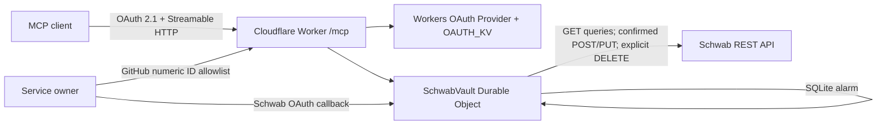

# Schwab MCP on Cloudflare Workers

这是一个单用户远程 MCP。它把 Charles Schwab 的生产 REST 行情、账户查询以及受确认保护的真实建单、改单、撤单能力暴露为 Streamable HTTP MCP，并运行在 Cloudflare Workers。MCP 客户端通过 Worker 自己签发的 OAuth 令牌访问 `/mcp`；GitHub OAuth 只用于确认服务拥有者身份，Schwab OAuth 凭据、交易状态和延迟任务只保存在 SQLite-backed Durable Object 中。

## 工具与交易边界

查询工具：

- `schwab_connection_status`
- `get_quotes`
- `get_price_history`
- `get_option_chain`
- `get_option_expiration_chain`
- `get_market_hours`
- `get_movers`
- `search_instruments`
- `list_accounts`
- `get_account`
- `get_orders`
- `get_order`
- `get_transactions`
- `get_user_preferences`

交易工具：

- `enable_trading`：只读取部署配置控制的总开关，不能通过 MCP 开启
- `prepare_trade`：冻结即时或延迟建单/改单快照并签发一次性确认令牌
- `confirm_trade`：消费确认令牌；即时任务立即提交，延迟任务只激活
- `cancel_order`：按明确用户指令撤单，不要求二次确认
- `list_delayed_trades`
- `cancel_delayed_trade`：立即取消仍处于 `ACTIVE` 的任务

AI 不得主动建议、发起或诱导交易。`prepare_trade` 只能响应用户明确提出的交易指令，`confirm_trade` 只能在用户原样复述返回的 `confirmationText` 后调用。这个约束由 MCP 工具说明、冻结摘要和审计记录落实，但 MCP 服务端无法看到原始聊天角色，因此它不是可信客户端签名，也不能从密码学上证明一句话由用户输入。

账户参数只接受 Schwab `hashValue`。官方 Schwab Order JSON 会透传给 Trader API，但会先限制为 64 KiB、最多 16 层和 2048 个节点，并拒绝完整账号、authorization、token 及原型污染键。服务端不设置单笔名义金额、数量或日累计硬上限；风险判断依赖每次确认时展示的完整冻结快照。

## 总开关

`ENABLE_TRADING` 是唯一总开关，默认值为 `false`。只有把部署配置改为严格小写的 `true` 并重新部署后，才能准备、确认、激活或触发建单/改单。MCP 工具不能修改这个值。

关闭总开关时：

- 新的建单/改单准备和确认失败关闭；
- 已确认的延迟任务保持 `ACTIVE`，停止读取条件和提交订单，每 15 分钟检查一次部署配置；
- `cancel_order` 和 `cancel_delayed_trade` 仍可使用，确保可以降险。

## 二次确认流程

即时建单或改单：

1. 客户端以 `executionMode: "IMMEDIATE"` 调用 `prepare_trade`。
2. 服务端持久化不可变订单快照、原始用户指令摘要和 `intentDigest`，返回五分钟有效的 `confirmationToken` 与 `confirmationText`。
3. 用户必须原样复述 `confirmationText`。
4. 客户端调用 `confirm_trade`；服务端原子消费令牌后才向 Schwab 提交。令牌不能重放。

延迟建单或改单：

1. 客户端把自然语言条件翻译为下述确定性条件树，连同订单、`validUntil` 和轮询间隔调用 `prepare_trade`。
2. 用户在发出指令时完成同样的二次确认；`confirm_trade` 只激活任务。
3. Durable Object alarm 检查冻结的时间和 Schwab 行情条件。命中后直接执行，不再询问。
4. 修改任务时传入 `replacesTaskId`，生成新版本并重新确认；旧版本只在新版本确认后取消。取消活动任务不要求二次确认。

支持的条件节点：

- `ALL`、`ANY`、`NOT`
- `TIME`：`BEFORE`、`AT_OR_BEFORE`、`AFTER`、`AT_OR_AFTER`
- `QUOTE`：比较 `askPrice`、`bidPrice`、`lastPrice`、`mark`、`netPercentChangeInDouble` 或 `totalVolume`

单个条件树最多引用 50 个代码，轮询间隔为 15 秒到 1 小时，`validUntil` 必须在未来一年内。AI 只负责在确认前把条件冻结成这套可审计规则；实际执行阶段不调用模型，不允许开放式新闻判断或任意代码。

## 写入与幂等

建单使用 `POST /accounts/{accountHash}/orders`，改单使用 `PUT /accounts/{accountHash}/orders/{orderId}`，撤单使用对应 `DELETE`。交易写入会先持久化 `EXECUTING`，再访问 Schwab；Durable Object alarm 即使至少执行一次，也不会自动重复提交同一个任务。

交易写入只允许首次 401 后刷新 token 并重试一次。429、其他 4xx 不重试；网络错误或 5xx 也不重试，并返回 `EXECUTION_UNCERTAIN`。出现该状态时必须先用 `get_orders` 或 `get_order` 核实实际订单，禁止直接重放。查询请求仍维持原有规则：401、429、5xx 各最多重试一次。

## 运行结构



每个 MCP 请求创建新的 `McpServer`。Schwab token、到期时间、一次性 OAuth state、确认提案、延迟任务和仅含摘要的交易审计记录放在单个 owner `SchwabVault` Durable Object 中。对象会合并并发 refresh、在 access token 到期前五分钟刷新，并通过 SQLite 条件更新原子消费确认令牌。确认令牌的明文只返回一次，持久化时只保存 SHA-256 摘要。

## 本地配置

需要 Node.js 20 或更新版本。

```bash
npm install
cp .dev.vars.example .dev.vars
```

编辑 `wrangler.jsonc`：

1. 把 `GITHUB_CLIENT_ID` 换成 GitHub OAuth App 的 Client ID。
2. 把 `ALLOWED_GITHUB_USER_ID` 换成你不可变的 GitHub numeric user ID。
3. `SCHWAB_REDIRECT_URI` 已按当前账户子域名配置为 `https://schwab-mcp.siruichen461.workers.dev/auth/schwab/callback`。
4. 创建 KV namespace，然后把返回的 ID 写入 `OAUTH_KV`：

```bash
npx wrangler kv namespace create OAUTH_KV
```

5. `ENABLE_TRADING` 保持 `false` 完成只读验证。只有准备开放真实交易时才改为 `true` 并重新部署；不要把它当作 MCP 参数或秘密令牌。

本地秘密只放在 `.dev.vars`：`GITHUB_CLIENT_SECRET`、`SCHWAB_CLIENT_ID`、`SCHWAB_CLIENT_SECRET`。`.dev.vars` 已被 Git 忽略。

GitHub OAuth App 的 callback URL 必须是：

```text
https://schwab-mcp.siruichen461.workers.dev/auth/github/callback
```

Schwab Production App 的 callback URL 必须和 `SCHWAB_REDIRECT_URI` 完全一致，包括协议、主机、路径和大小写。

## 验证

```bash
npm run types
npm run typecheck
npm run lint
npm test
```

测试使用 Vitest 和 Cloudflare Workers 测试池，覆盖 OAuth state、GitHub numeric ID 白名单、令牌脱敏、refresh 并发与重试、交易 schema、敏感字段拒绝、一次性确认、防重放、写请求不重试和 Durable Object alarm 延迟执行。测试中的 Schwab 写请求全部是模拟响应，不会访问真实账户。

## 部署

先把生产秘密写入 Cloudflare：

```bash
npx wrangler secret put GITHUB_CLIENT_SECRET
npx wrangler secret put SCHWAB_CLIENT_ID
npx wrangler secret put SCHWAB_CLIENT_SECRET
npm run deploy
```

首次部署必须保持 `ENABLE_TRADING: "false"`，完成 OAuth 和查询验证后再决定是否修改配置并二次部署。一次成功部署、模拟测试或 MCP 工具可见都不证明真实 Schwab 建单已验证。

部署后访问以下地址完成 Schwab 授权：

```text
https://schwab-mcp.siruichen461.workers.dev/auth/schwab/connect
```

远程 MCP 地址是：

```text
https://schwab-mcp.siruichen461.workers.dev/mcp
```

`/health` 只返回运行状态和版本，不返回 Schwab 连接状态或账户数据。

## 日志与排错

Workers structured logs 记录：

- `event`
- `requestId`
- `tool`
- `status`
- `attempts`
- `durationMs`

主要事件为 `schwab_api_request`、`schwab_token_refresh`、`schwab_response_invalid`、`github_oauth_failed`、`schwab_oauth_failed` 和 `mcp_handler_error`。交易审计只保存指令摘要、意图摘要、状态、实体 ID 和 `requestId`。日志不记录订单 JSON、请求头、OAuth code、access token、refresh token 或完整账号。查看生产日志：

```bash
npx wrangler tail schwab-mcp --format json
```

错误通过 MCP `isError: true` 返回稳定错误码。除原有 `AUTH_REQUIRED`、`REAUTHORIZATION_REQUIRED`、`INVALID_ARGUMENT`、`RATE_LIMITED`、`SCHWAB_REJECTED`、`UPSTREAM_UNAVAILABLE` 外，交易流程还会返回 `CONFIRMATION_INVALID`、`CONFIRMATION_EXPIRED`、`TRADE_NOT_FOUND`、`TRADE_STATE_CONFLICT` 和 `EXECUTION_UNCERTAIN`。`AUTH_REQUIRED` 和 `REAUTHORIZATION_REQUIRED` 会附带 `reconnectUrl`；成功结果在授权剩余不足 24 小时时附带 `meta.authorizationNotice`。上游错误不会转换为空结果。
