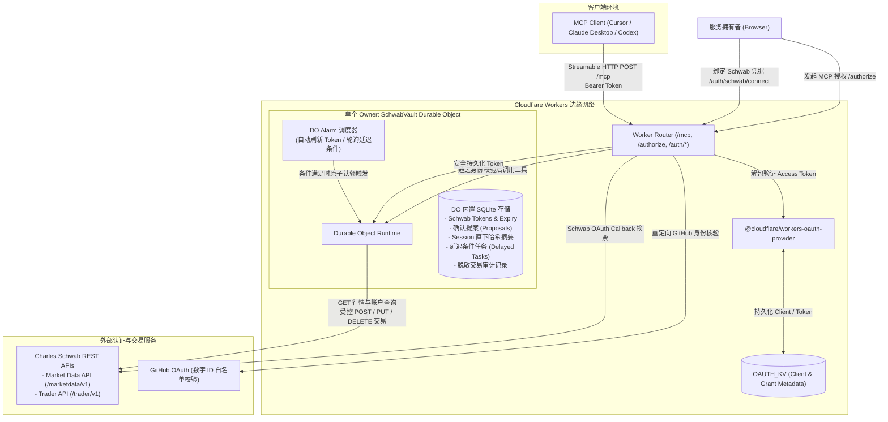
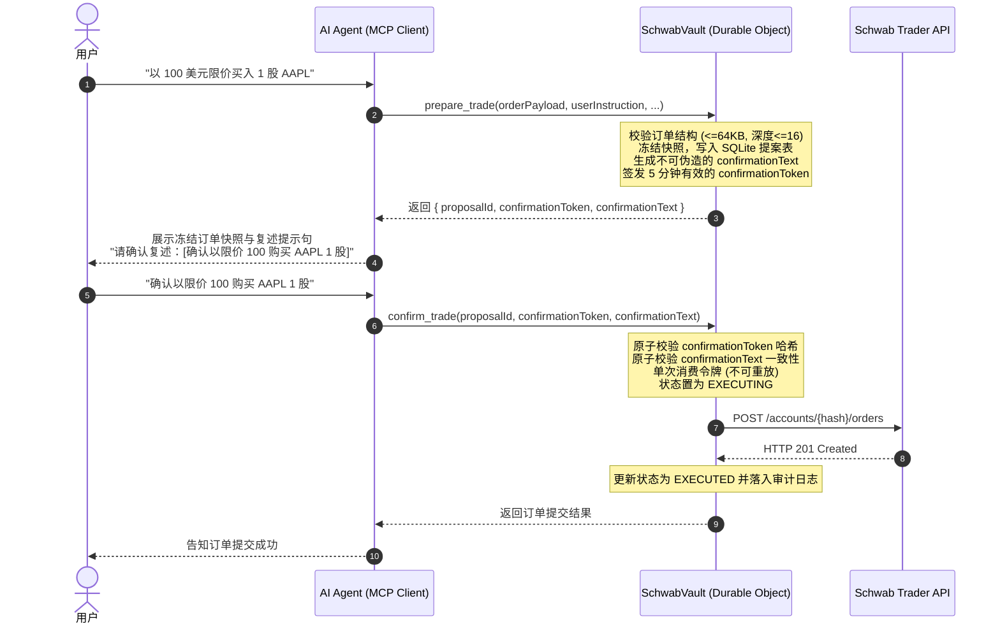

# Schwab MCP on Cloudflare Workers

[English](README.md) | 简体中文

[](https://www.typescriptlang.org/)
[](https://workers.cloudflare.com/)
[-success?logo=cloudflare&logoColor=white)](https://workers.cloudflare.com/)
[](https://glama.ai/mcp/servers/chensirui2008/schwab-mcp)
[](https://modelcontextprotocol.io/)
[](https://vitest.dev/)
[](LICENSE)

> [!CAUTION]
> **免责声明 (Disclaimer)**  
> 本项目仅供技术学习、个人研究及自动化实验使用，**不构成任何投资建议、财务咨询或交易撮合指令**。  
> 证券与期权交易具有重大本金亏损风险。使用本项目直接或间接连接真实券商交易接口时，用户须自行承担因 API 异常、网络延迟、大语言模型幻觉输出、不可抗力或软件缺陷导致的一切投资风险与资金损失。本项目作者及贡献者概不对任何交易后果与损失承担法律责任。

这是一个运行在 **Cloudflare Workers** 上的**个人自托管（Self-Hosted）专用高安全性远程 Model Context Protocol (MCP) 服务**。完全部署在您个人的 Cloudflare 账户内（**兼容 100% 免费额度 Free Tier**，无需任何 VPS、服务器租用或常开家用主机）。它将 Charles Schwab 生产环境的官方 REST 行情、账户资产查询，以及经过严格安全防护的真实建单、改单与撤单能力封装为标准的 **Streamable HTTP MCP** 接口（暴露在 `/mcp` 端点）。

本服务以**零信任安全、严格的数据隔离与防幻觉交易保护**为核心设计原则：客户端访问通过 Worker 自建的 OAuth 2.1 服务鉴权，仅限绑定的不可变 GitHub 用户 ID 访问；Schwab 敏感凭据、交易状态、条件任务完全隔离在持久化 SQLite-backed Durable Object (`SchwabVault`) 中。

## ⚡ 一句话快速上手（AI Agent 自动化部署）

使用 **Cursor**、**Claude Code**、**Windsurf** 或 **Codex**？克隆本项目后，直接对你的 AI 编程助手发送这句指令：

> 💬 **“请阅读 `setup.md`，一步步指导我配置并部署这个 Schwab MCP 服务到我的 Cloudflare 账户。”**

你的 AI Agent 将自动检查前置工具链、开通 Cloudflare KV 资源、安全注入 Secrets、运行校验并一键部署到边缘网络！

---

## 目录

- [一句话快速上手（AI Agent 自动化部署）](#-一句话快速上手ai-agent-自动化部署)
- [核心架构与设计原则](#核心架构与设计原则)
- [架构对比 (为什么选择 Cloudflare Workers？)](#架构对比-为什么选择-cloudflare-workers)
- [系统架构图](#系统架构图)
- [典型 AI 交互场景演示](#典型-ai-交互场景演示)
- [工具清单与参数规格](#工具清单与参数规格)
  - [只读与诊断工具 (15 个)](#1-只读与诊断工具-15-个)
  - [交易控制工具 (9 个)](#2-交易控制工具-9-个)
- [安全边界与交易防护机制](#安全边界与交易防护机制)
  - [1. 部署总开关 (ENABLE_TRADING)](#1-部署总开关-enable_trading)
  - [2. AI 零主动交易原则 (Anti-Hallucination)](#2-ai-零主动交易原则-anti-hallucination)
  - [3. 默认二次确认机制 (Two-Phase Confirmation)](#3-默认二次确认机制-two-phase-confirmation)
  - [4. Agent Session 临时直下模式 (Session Direct Trading)](#4-agent-session-临时直下模式-session-direct-trading)
  - [5. 确定性延迟条件交易 (Delayed Conditional Orders)](#5-确定性延迟条件交易-delayed-conditional-orders)
  - [6. 写请求网络防重放与不确定状态 (EXECUTION_UNCERTAIN)](#6-写请求网络防重放与不确定状态-execution_uncertain)
  - [7. 报文深度安全校验与敏感数据脱敏](#7-报文深度安全校验与敏感数据脱敏)
- [本地开发与配置](#本地开发与配置)
  - [环境准备](#环境准备)
  - [本地配置文件](#本地配置文件)
  - [本地 Cloudflare MCP 支持 (.mcp.json)](#本地-cloudflare-mcp-支持-mcpjson)
- [自动化验证与测试](#自动化验证与测试)
- [生产部署指南](#生产部署指南)
  - [步骤 1：创建 Cloudflare 资源与 Secrets](#步骤-1创建-cloudflare-资源与-secrets)
  - [步骤 2：执行首次只读部署](#步骤-2执行首次只读部署)
  - [步骤 3：配置 GitHub Actions 自动化部署流水线](#步骤-3配置-github-actions-自动化部署流水线)
  - [步骤 4：完成 Schwab 账户首次授权绑定](#步骤-4完成-schwab-账户首次授权绑定)
- [MCP 客户端接入配置](#mcp-客户端接入配置)
- [错误码对照与运维排错](#错误码对照与运维排错)
  - [公开错误码字典](#公开错误码字典)
  - [授权到期预警通知](#授权到期预警通知)
  - [实时结构化日志监控](#实时结构化日志监控)

---

## 核心架构与设计原则

1. **协议规范与无状态会话**：
   采用 `@modelcontextprotocol/server` v2 的 `createMcpHandler`，通过 `/mcp` 端点提供无协议会话（stateless per-request）的 Streamable HTTP 服务。跨域请求原生支持 CORS。
2. **OAuth 2.1 + GitHub 身份白名单**：
   使用 `@cloudflare/workers-oauth-provider` 实现 MCP 客户端动态注册与授权。OAuth 授权流程必须通过 GitHub OAuth 确认服务拥有者身份，仅当不可变 GitHub 数字 ID 完全匹配环境变量 `ALLOWED_GITHUB_USER_ID` 时才予放行。
3. **每客户端 OAuth 权限边界**：
   - MCP OAuth 使用 `schwab.read` 服务访问 scope。每个客户端在授权页独立选择**只读（Read only，默认）**或**完整访问（Full access）**，选择随一次性浏览器 state 传入 GitHub owner 校验流程，存入 grant 的加密 props，并在刷新 token 后保持。
   - 只读客户端仅注册账户、行情与诊断工具；全部 9 个交易控制工具不向模型暴露，直接指定交易工具名调用同样失败。完整访问客户端注册所有工具，真实交易仍受部署总开关 `ENABLE_TRADING`、明确用户指令、二次确认或原有 session 能力约束，撤单例外保持。
   - `get_trading_diagnostics` 始终可见，返回当前客户端的 `permissionLevel`、交易工具注册状态、部署总开关和有效交易状态。只读授权的有效交易状态为 `DISABLED_BY_PERMISSION`。
4. **SQLite 物理级凭据与状态隔离**：
   Schwab OAuth Token、刷新时间、一次性确认提案、Session 直下能力哈希、延迟条件订单及脱敏交易审计摘要**严格存储于 SQLite-backed `SchwabVault` Durable Object 内**。凭据和原始订单明文严禁进入 KV 存储或日志。
5. **Session 直下凭证单次暴露与哈希存储**：
   Session 直下能力明文令牌仅在 `enable_session_direct_trading` 响应中返回一次，Durable Object 内部只持久化其 SHA-256 哈希摘要，日志与审计记录永不记录明文。


## 架构对比 (为什么选择 Cloudflare Workers？)

| 核心特性 | 常见本地 MCP (Python / stdio) | **本项目 (schwab-mcp on Workers)** |
| :--- | :--- | :--- |
| **自托管成本与运维** | 依赖本地电脑开机常驻，或购买云服务器/VPS（每月 $5~$20） | **个人 Cloudflare 账户 100% 免费自托管（$0/月，零硬件与运维开销）** |
| **数据与凭据主权** | 本地明文文件，易误删、遗失或被恶意脚本窃取 | **100% 私有自托管：凭据锁在个人 DO SQLite 内，无任何第三方商业中转** |
| **运行与部署** | 本地单机常驻进程（休眠/关机即断开） | **Cloudflare Workers 边缘网络（24/7 全球无服务器托管，秒级冷启动）** |
| **多端支持** | 仅限当前单台电脑 | **标准 Streamable HTTP (`/mcp`)，Cursor、Claude Desktop、VS Code、多设备共享** |
| **凭据存储** | 本地明文 JSON 或环境变量 | **Durable Object SQLite 物理隔离，凭据永不泄漏至 KV 或日志** |
| **权限控制** | 单一权限全量暴露 | **OAuth 2.1 粒度隔离：每个客户端独立选 `read_only`（只读）或 `full_access`（完整）** |
| **交易安全护栏** | 缺乏防护，模型幻觉极易误下单 | **部署总开关 (`ENABLE_TRADING`) + 强制原文复述二次确认 + Session 临时能力** |
| **条件单/延迟单** | 电脑关机无法执行 | **Durable Object Alarms 原生支持边缘自主触发与确定性条件单** |
| **网络异常容错** | 盲目重试可能导致重复扣单 | **网络异常标记 `EXECUTION_UNCERTAIN`，阻断自动重放，确保资金安全** |

---

## 系统架构图



---

## 典型 AI 交互场景演示

### 1. 资产透视与期权链分析（只读模式）

> **用户**：“帮我查一下当前 NVDA 的持仓盈亏，顺便看一下下个月到期、行权价 140 的 Call 表现如何？”  
> **Agent**：*(自动调用 `get_account` 与 `get_option_chain`)*  
> “您当前持有 NVDA 100 股，均价 $118.40，浮盈 +18.2%。下个月到期的 $140 CALL 当前买卖价差为 $4.20 / $4.35，Delta 为 0.38，隐含波动率 IV 为 42.1%。”

### 2. 防幻觉两阶段确认建单（交易控制模式）

> **用户**：“帮我以限价 $220 买入 10 股 AAPL。”  
> **Agent**：*(调用 `prepare_trade` 冻结订单快照并生成防呆口令)*  
> “已为您生成并冻结订单提案（有效期 5 分钟）：  
> - **方向**：买入 10 股 AAPL @ 限价 $220.00 (当日有效)  
> - **账户**：`...8a9f`  
> - **提案 ID**：`prop_01JABC...`  
> ⚠️ **为确保资金安全，请原样复述以下确认短语以执行下单：**  
> `CONFIRM BUY 10 AAPL LIMIT 220.00 HASH 8a9f`”  
>  
> **用户**：`CONFIRM BUY 10 AAPL LIMIT 220.00 HASH 8a9f`  
> **Agent**：*(调用 `confirm_trade` 消费一次性令牌)*  
> “订单已成功提交至嘉信理财 (Charles Schwab)，委托编号：`#10098234`。”

---
---

## 工具清单与参数规格

系统共注册 **24 个 MCP 工具**，输入约束严格以 `src/schemas.ts` 的 Zod 校验为准。

### 1. 只读与诊断工具 (15 个)

这些工具不执行交易写操作；其中 Schwab 查询严格使用只读 HTTP `GET`，部署诊断仅读取当前 Worker 配置：

| 工具名称 | 功能描述 | 关键参数与格式要求 |
| :--- | :--- | :--- |
| `schwab_connection_status` | 检查 Schwab 账户授权连接状态及有效期限 | 无参数。成功返回连接状态、过期时间及刷新链接。 |
| `get_trading_diagnostics` | 诊断交易工具与部署总开关状态 | 无参数。始终可见；返回交易工具是否注册、`ENABLE_TRADING` 是否开启及有效交易状态，不修改配置、不提交订单。 |
| `get_quotes` | 批量获取实时行情快照 | `symbols`: 1~50 个股票/ETF/指数代码数组；<br>`fields`: 可选字段过滤 (`quote`, `fundamental`, `reference`, `extended`, `regular`)；<br>`indicative`: 可选布尔值。 |
| `get_price_history` | 获取标的 OHLCV K线历史数据 | `symbol`: 标的代码；<br>`periodType`: `day` \| `month` \| `year` \| `ytd`；<br>`frequencyType`: `minute` \| `daily` \| `weekly` \| `monthly`；<br>`frequency`: 聚合频率整数；<br>`startDate` / `endDate`: 可选毫秒时间戳 (须满足 start <= end)；<br>`needExtendedHoursData` / `needPreviousClose`: 可选布尔值。 |
| `get_option_chain` | 获取期权链合约、实时报价与 Greeks 希腊字母 | `symbol`: 标的代码；<br>`contractType`: `CALL` \| `PUT` \| `ALL`；<br>`strikeCount`: 1~100 档位行权价；<br>`strategy`: `SINGLE`, `VERTICAL`, `CALENDAR`, `STRADDLE` 等；<br>`fromDate` / `toDate`: `YYYY-MM-DD` 格式。 |
| `get_option_expiration_chain` | 获取标的期权的所有到期日列表 | `symbol`: 标的代码。 |
| `get_market_hours` | 查询指定市场指定日期的交易开放时间 | `markets`: 市场类型数组 (可选 `equity`, `option`, `bond`, `future`, `forex`，1~5 项)；<br>`date`: 可选 `YYYY-MM-DD` 格式。 |
| `get_movers` | 获取主要指数或市场的涨跌幅榜异动标的 | `index`: `$DJI` \| `$COMPX` \| `$SPX` \| `NYSE` \| `NASDAQ` \| `OTCBB` 等；<br>`sort`: `VOLUME` \| `TRADES` \| `PERCENT_CHANGE_UP` \| `PERCENT_CHANGE_DOWN`；<br>`frequency`: 聚合频率 (`0`, `1`, `5`, `10`, `30`, `60`)。 |
| `search_instruments` | 模糊搜索标的代码或证券基本面定义 | `symbol`: 标的代码关键字；<br>`projection`: `symbol-search` \| `symbol-regex` \| `desc-search` \| `desc-regex` \| `search` \| `fundamental`。 |
| `list_accounts` | 获取绑定的账户哈希列表 (自动剔除真实账号) | 无参数。仅返回 Schwab 专用 `hashValue` 列表。 |
| `get_account` | 获取指定哈希账户的实时余额与持仓信息 | `accountHash`: 16~256 字符的账户哈希值；<br>`includePositions`: 可选布尔值，是否包含当前持仓详情。 |
| `get_orders` | 获取跨关联账户的订单执行记录 | `fromEnteredTime`: ISO-8601 带时区时间戳 (例如 `2026-09-01T00:00:00Z`)；<br>`toEnteredTime`: ISO-8601 带时区时间戳；<br>`maxResults`: 可选整数，最大 3000；<br>`status`: 可选订单状态过滤。 |
| `get_order` | 查询单笔订单的最新执行明细 | `accountHash`: 账户哈希；<br>`orderId`: 正整数订单编号。 |
| `get_transactions` | 查询指定账户的历史资金流水与交割明细 | `accountHash`: 账户哈希；<br>`startDate` / `endDate`: `YYYY-MM-DD` 日期；请求 Schwab 时自动转换为覆盖完整起止日的 UTC ISO-8601 时间范围；<br>`types`: 可选交易类型；<br>`symbol`: 可选标的代码过滤。 |
| `get_user_preferences` | 获取账户上下文偏好设置与交易权限 | 无参数。 |

### 2. 交易控制工具 (9 个)

> [!WARNING]
> 以下工具仅向选择**完整访问**并通过 OAuth 与 GitHub owner 白名单校验的 MCP 客户端注册。`ENABLE_TRADING` 是允许准备、确认、开启 session 直下及提交订单的唯一部署总开关；关闭时相关调用失败关闭，但完整访问客户端仍可撤单、关闭 session 和取消延迟任务以降险。

| 工具名称 | 功能描述 | 关键参数与格式要求 |
| :--- | :--- | :--- |
| `enable_trading` | 查询部署配置中的交易总开关状态 | 无参数。**注意：此工具为只读查询，MCP 无法在线开启总开关，必须通过修改部署配置并重新部署。** |
| `prepare_trade` | 冻结即时或延迟交易快照，生成一次性二次确认令牌 | `accountHash`: 目标账户哈希；<br>`action`: `PLACE` (新建) \| `REPLACE` (修改)；<br>`executionMode`: `IMMEDIATE` (即时) \| `DELAYED` (延迟条件)；<br>`orderId`: 修改订单时必填订单 ID，新建订单禁止传入；<br>`orderPayload`: 官方 Schwab Order JSON（最大 64 KiB，严格深度限制）；<br>`userInstruction`: 用户明确交易指令文字 (1~4000 字符)；<br>`condition` / `validUntil` / `pollIntervalSeconds` / `replacesTaskId`: 延迟订单必填条件参数。 |
| `confirm_trade` | 提交复述文本并消费一次性确认令牌 | `proposalId`: 提案 UUID；<br>`confirmationToken`: 43 字符一次性令牌；<br>`confirmationText`: 必须完全一致复述由 `prepare_trade` 生成的确认确认句。 |
| `enable_session_direct_trading` | 在用户明确指令下开启当前 Agent 会话直下能力 | `userInstruction`: 明确的用户开启指令。<br>返回敏感 `sessionCapability` (43 字符)，全局仅返回一次。 |
| `place_order_direct` | 使用 Session 直下能力提交即时建单 (绕过逐单确认) | `sessionCapability`: 43 字符 Session 令牌；<br>`executionKey`: 客户端生成的幂等 UUID；<br>`accountHash`: 账户哈希；<br>`orderPayload`: 订单载荷；<br>`userInstruction`: 当前单笔下单的明确用户指令。 |
| `disable_session_direct_trading` | 立即注销并作废 Session 直下能力 | `sessionCapability`: 43 字符 Session 令牌。 |
| `cancel_order` | 撤销 Schwab 市场中的活动订单 | `accountHash`: 账户哈希；<br>`orderId`: 订单 ID；<br>`userInstruction`: 明确的用户撤单指令。**无需二次确认，允许在交易总开关关闭时运行以快速降险。** |
| `list_delayed_trades` | 查询已持久化的延迟条件任务列表及状态 | `status`: 可选过滤状态 (`ACTIVE`, `EXECUTING`, `EXECUTED`, `FAILED`, `EXECUTION_UNCERTAIN`, `CANCELLED`, `EXPIRED`)。 |
| `cancel_delayed_trade` | 立即取消处于 `ACTIVE` 状态的延迟任务 | `taskId`: 任务 UUID；<br>`userInstruction`: 明确的用户取消指令。**无需二次确认。** |

---

## 安全边界与交易防护机制

### 1. 部署总开关 (`ENABLE_TRADING`)

- `ENABLE_TRADING` 是配置在 `wrangler.jsonc`（或 Cloudflare 部署环境变量）中的**绝对最高控制权总开关**，默认值为 `false`。
- **总开关为 `false` 时**：
  - 严禁准备 (`prepare_trade`)、严禁确认 (`confirm_trade`)、严禁开启 Session 直下 (`enable_session_direct_trading`)、严禁提交直下订单 (`place_order_direct`)；
  - 已经处于 `ACTIVE` 的延迟任务全部**暂停条件检查与订单触发**，Durable Object alarm 降频为每 15 分钟检查一次配置状态；
  - 撤单操作 `cancel_order` 与 `cancel_delayed_trade` **保持可用**，确保在发生意外或风险收敛时能及时撤回敞口。
- **开启方式**：必须在 `wrangler.jsonc` 中将 `ENABLE_TRADING` 设为小写的 `"true"` 并执行 `npm run deploy`。MCP 工具本身无权在线修改该值。

### 2. AI 零主动交易原则 (Anti-Hallucination)

- AI **严禁**主动发起交易建议、诱导交易或自动撮合。
- `prepare_trade`、`enable_session_direct_trading` 以及每一次 `place_order_direct` 必须严格由用户输入明确意图触发，且必须将用户的原始输入作为 `userInstruction` 传入。
- 工具说明、冻结快照与数据库审计记录会同步存储意图摘要 (`intentDigest`)；AI 生成的分析文本不能冒充用户指令签名。

### 3. 默认二次确认机制 (Two-Phase Confirmation)

为防止大语言模型产生幻觉误发订单，默认即时下单与所有订单修改必须执行两阶段确认：



- **不可变快照**：订单一旦进入 `prepare_trade` 即在 SQLite 中被冻结，任何改动均须重新准备并生成新的令牌。
- **单次消费与防重放**：`confirmationToken` 有效期为 5 分钟，在数据库条件事务中原子消费，消费后立即作废，杜绝并发重放。

### 4. Agent Session 临时直下模式 (Session Direct Trading)

由于 MCP 采用无状态 Streamable HTTP，服务端无法获知客户端聊天窗口何时关闭。本服务提供了一套严格约束的会话级即时直下机制：

- **能力范围**：**仅限即时新建单 (`IMMEDIATE` + `PLACE`)**。即时改单 (`REPLACE`) 以及任何延迟条件单必须回到二次确认流程。
- **单次可见性**：调用 `enable_session_direct_trading` 成功后，明文 `sessionCapability` (43 字符) **仅返回一次**。Durable Object 内部仅保存其 SHA-256 哈希值，日志及返回结果绝不再暴露明文。
- **自动失效与续期**：
  - **30 分钟闲置失效**：若连续 30 分钟无有效调用，该 Capability 自动失效；
  - **调用自动续期**：每次成功调用 `place_order_direct`，闲置计时器自动顺延 30 分钟；
  - **8 小时硬上限**：自初次签发起，绝对生命周期最长为 8 小时，到期强制作废。
- **幂等认领 (`executionKey`)**：
  - 每次直下调用客户端必须生成全新的 UUID 作为 `executionKey`；
  - 同一 Session 内若发生网络抖动或重试，**相同 `executionKey` 且订单载荷完全一致的请求不会重复提交**，直接返回先前已持久化的执行结果；若相同键绑定了不同订单载荷，则直接失败关闭。

### 5. 确定性延迟条件交易 (Delayed Conditional Orders)

延迟交易仅支持可穷举、确定性的逻辑判断，杜绝开放式非确定性模型推理：

- **支持的条件节点 (AST 结构)**：
  - 组合节点：`ALL` (全部满足)、`ANY` (任意满足)、`NOT` (逻辑非)；
  - 时间节点：`TIME`，支持比较操作符 `BEFORE`, `AT_OR_BEFORE`, `AFTER`, `AT_OR_AFTER`；
  - 行情节点：`QUOTE`，支持字段 `askPrice`, `bidPrice`, `lastPrice`, `mark`, `netPercentChangeInDouble`, `totalVolume`，支持操作符 `LT`, `LTE`, `EQ`, `GTE`, `GT`。
- **执行规则**：
  - 单个条件树引用的标的总数不得超过 50 个；
  - `validUntil` 必须指定且在未来 1 年以内；
  - 轮询间隔 `pollIntervalSeconds` 介于 15 秒至 3600 秒（1小时）之间；
  - 条件监控由 Durable Object Alarm 驱动。当条件达成时，在 SQLite 事务中原子校验 `validUntil`，若仍有效则直接提交订单，不需二次询问用户；
  - 若上游行情格式异常或缺失必需数字字段，任务**立即失败关闭**，标记 `FAILED` 并记录结构化事件，严禁模糊猜测。

### 6. 写请求网络防重放与不确定状态 (`EXECUTION_UNCERTAIN`)

- **写路径限制**：真实写请求仅允许 `POST /accounts/{hash}/orders` (建单)、`PUT /accounts/{hash}/orders/{orderId}` (改单) 与 `DELETE /accounts/{hash}/orders/{orderId}` (撤单)。
- **重试原则**：
  - 交易写入请求在遭遇首次 401 Unauthorized 时，会自动刷新 Schwab Access Token 并**重试一次**；
  - 遭遇 429、其他 4xx、网络超时或 5xx 时，**严禁自动重试**；
  - 若在发出写入请求后遇到网络断开或 5xx，系统将订单状态置为 **`EXECUTION_UNCERTAIN`** 并记录 `requestId`。此时**绝对禁止盲目重放订单**，客户端和用户必须先通过 `get_orders` 或 `get_order` 手动排查真实成交情况。

### 7. 报文深度安全校验与敏感数据脱敏

- **载荷大小限制**：官方 Schwab Order JSON 经 UTF-8 编码后体积不得超过 **64 KiB**。
- **结构防溢出**：JSON 递归深度不得超过 **16 层**，总节点数量不得超过 **2048 个**。
- **敏感关键字阻断**：载荷中如果含有 `accountNumber`, `access_token`, `authorization`, `confirmationToken`, `sessionCapability`, `__proto__`, `constructor` 等字段，将直接触发校验拦截并阻断。
- **账户脱敏**：对外只接受 Schwab 生成的不可逆 `accountHash` (`hashValue`)，明文账号在序列化输出和日志中会被强制剔除。

---

## 本地开发与配置

### 环境准备

- **Node.js**: 20.0.0 或更高版本 (推荐 Node.js 22 LTS)
- **Cloudflare 账户**: 拥有 Workers 与 Durable Objects 权限
- **GitHub 账户**: 创建用于身份校验的 GitHub OAuth App
- **Charles Schwab Developer 账户**: 拥有 Approved 状态的 Schwab Developer App

### 本地配置文件

1. 安装依赖：
   ```bash
   npm install
   ```

2. 准备本地秘密变量：
   ```bash
   cp .dev.vars.example .dev.vars
   ```
   编辑 `.dev.vars`（此文件已被 `.gitignore` 排除，仅用于本地 `wrangler dev`）：
   ```ini
   GITHUB_CLIENT_SECRET="你的 GitHub OAuth App Client Secret"
   SCHWAB_CLIENT_ID="你的 Schwab App App Key"
   SCHWAB_CLIENT_SECRET="你的 Schwab App Secret"
   ```

   `wrangler.jsonc` 的 `secrets.required` 只记录上述三个 Secret 的名称，用于本地启动、类型生成和部署前的缺失检查，不包含任何密钥值。`.dev.vars*` 和 `.env*` 已被 Git 忽略；两种格式二选一，不要同时使用。本地文件不会自动上传到生产环境。

3. 调整 `wrangler.jsonc` 中的环境变量：
   - `GITHUB_CLIENT_ID`: 你的 GitHub OAuth App Client ID；
   - `ALLOWED_GITHUB_USER_ID`: 你的不可变 GitHub 数字 ID（可通过 `curl -s https://api.github.com/users/<你的用户名> | grep '"id":'` 查询）；
   - `SCHWAB_REDIRECT_URI`: 生产/测试回调地址，格式如 `https://<worker-name>.<subdomain>.workers.dev/auth/schwab/callback`；
   - `ENABLE_TRADING`: 本地开发验证初期请**严格保持为 `"false"`**。

4. GitHub OAuth App 回调地址配置：
   - **Authorization callback URL**:
     `https://<worker-name>.<subdomain>.workers.dev/auth/github/callback`
     （本地联调时如使用本地隧道，请对应替换协议与域名）。

5. Schwab App 回调地址配置：
   - **Callback URL**: 必须与 `SCHWAB_REDIRECT_URI` 完全一致（包含大小写、端口及路径）。

### 本地 Cloudflare MCP 支持 (`.mcp.json`)

项目根目录的 `.mcp.json` 配置了 Cloudflare 官方远程 MCP 服务（Bindings、Builds、Docs、Observability 等）。该文件只包含公开 URL，完全不含凭据。支持项目级 MCP 的客户端会在初次使用时引导完成 Cloudflare OAuth 授权。

---

## 自动化验证与测试

本项目采用严苛的代码质量与类型保障机制，在提交前请运行统一验证命令：

```bash
npm run validate
```

该命令将按顺序执行：
1. `npm run types`: 同步 Cloudflare Workers 运行时环境类型 (`env.d.ts`)；
2. `npm run typecheck`: TypeScript 严格类型检查 (`tsc --noEmit`)；
3. `npm run lint`: ESLint 代码规范扫描；
4. `npm run test`: Vitest 运行覆盖完整的单元与集成测试。

> [!NOTE]
> 测试套件深度利用 `@cloudflare/vitest-pool-workers` 在真实 Workers 隔离沙箱内模拟 Durable Object 运行时、SQLite 数据表流转、Alarm 唤醒与 API 边界断言。所有 Schwab 外部调用在测试中均为沙盒 Mock，不会产生任何实际网络费用或交易操作。

---

## 生产部署指南

### 步骤 1：创建 Cloudflare 资源与 Secrets

1. 创建 OAuth 存储专用的 KV Namespace：
   ```bash
   npx wrangler kv namespace create OAUTH_KV
   ```
   将终端输出的 `id` 填入 `wrangler.jsonc` 的 `kv_namespaces` 列表中：
   ```jsonc
   "kv_namespaces": [
     {
       "binding": "OAUTH_KV",
       "id": "<你的 KV Namespace ID>"
     }
   ]
   ```

2. 上传 Worker 运行时私密凭据：
   ```bash
   npx wrangler secret put GITHUB_CLIENT_SECRET
   npx wrangler secret put SCHWAB_CLIENT_ID
   npx wrangler secret put SCHWAB_CLIENT_SECRET
   ```

   上述命令会交互式读取密钥，不要把密钥值写入命令行、仓库或 GitHub Actions。`wrangler secret put` 会创建并立即部署新版本；若需要先暂存版本再发布，使用 `wrangler versions secret put <NAME>` 后再显式部署该版本。已配置的生产 Secret 无需因本次 `secrets.required` 声明重新上传；可先用 `npx wrangler secret list` 只读检查名称。

### 步骤 2：执行首次只读部署

确认 `wrangler.jsonc` 中 `ENABLE_TRADING` 为 `"false"`，然后执行：
```bash
npm run deploy
```

部署完成后，Worker 会生成分配的子域名，例如：
`https://<your-worker-name>.<your-subdomain>.workers.dev`

**0.2.0 升级与重新授权**：此版本启用 `AUTHORIZATION_VERSION = "client-permissions-v1"`。部署后，所有此前的 MCP access token、refresh token 和未兑换的 authorization code 都失效：访问 `/mcp` 返回 HTTP 401 `invalid_token`，旧 code 或 refresh token 换票返回 HTTP 400 `invalid_grant`。每个客户端必须重新打开授权页，选择权限并完成 GitHub 身份校验；旧 grant 不会在刷新时自动升级。已注册的客户端可复用原 client ID，无需删除 KV。Schwab 账户绑定、已有延迟交易任务及交易确认规则保持不变，无需重新绑定 Schwab。

之后需要再次全量过期 MCP 授权时，修改 `src/oauth-access.ts` 中的 `AUTHORIZATION_VERSION` 后部署；普通 `APP_VERSION` 更新不会自动作废当前授权。对同一客户端重新授权以修改权限时，服务先显式撤销该客户端的旧 grant 和 token，全部撤销成功后才签发新授权；其他客户端的授权不受影响。若查询或撤销旧授权失败，返回 HTTP 503 `temporarily_unavailable` 和可关联的 `requestId`，不会签发新授权；权限修改尚未完成，旧授权可能仍有效，需要重新发起授权流程。

### 步骤 3：配置 GitHub Actions 自动化部署流水线

仓库已配置自动化工作流 [`.github/workflows/deploy.yml`](.github/workflows/deploy.yml)，当代码合并或推送到 `main` 分支时自动触发全量类型、代码校验并部署。流水线支持通过 GitHub Actions 环境变量动态注入配置，从而实现**开源代码与个人生产配置完全解耦**。

请在 GitHub 仓库 **Settings** → **Secrets and variables** → **Actions** 中添加：

**1. Repository Secrets（加密凭据）**：
- `CLOUDFLARE_ACCOUNT_ID`: 你的 Cloudflare 账户 ID；
- `CLOUDFLARE_API_TOKEN`: 具备该 Worker 编辑与部署最小权限的 Cloudflare API Token。

**2. Repository Variables（部署注入参数，用于将个人配置与代码库剥离）**：
- `PROD_OAUTH_KV_ID`: 步骤 1 创建的 `OAUTH_KV` 空间 ID；
- `PROD_ALLOWED_GITHUB_USER_ID`: 你的不可变 GitHub 数字 ID；
- `PROD_GITHUB_CLIENT_ID`: 你的 GitHub OAuth App Client ID；
- `PROD_SCHWAB_REDIRECT_URI`: 你的生产回调地址（格式为 `https://<your-worker-name>.<your-subdomain>.workers.dev/auth/schwab/callback`）；
- `PROD_ENABLE_TRADING`: （可选）是否在生产开启交易，若开启填 `true`，关闭填 `false`（不加引号；默认 `false`）。

部署前运行 `npm run configure:deploy`，从上述环境变量写入本次构建的 `wrangler.jsonc`；缺失必需配置或无效的 KV ID、数字用户 ID、回调地址、交易开关会立即失败。该命令不读取或写入 Worker Secrets，请勿提交注入后的配置文件。

如果同时启用 Cloudflare **Workers Builds**，GitHub Actions 的 Repository Variables 不会自动传入该构建环境。需在每个触发器的 Build variables 中配置同名参数，并设置 Build command 为 `npm run validate && npm run configure:deploy`。生产分支的 Deploy command 保持 `npx wrangler deploy`，非生产分支保持 `npx wrangler versions upload`（仅上传版本，不切换生产流量）；非生产构建的 `PROD_ENABLE_TRADING` 使用 `false`。测试使用独立的虚构身份配置，无需生产参数。

> [!CAUTION]
> 严禁把 `GITHUB_CLIENT_SECRET`、`SCHWAB_CLIENT_ID` 或 `SCHWAB_CLIENT_SECRET` 上传到 GitHub Actions Secrets！这三项凭据仅应保存在 Cloudflare Worker Secrets 中。

### 步骤 4：完成 Schwab 账户首次授权绑定

部署成功后，服务拥有者需使用浏览器访问：
```text
https://<your-worker-domain>/auth/schwab/connect
```
**授权流程**：
1. 页面重定向至 GitHub 进行身份验证，核对访问者的 GitHub 数字 ID 是否在白名单中；
2. 身份核验通过后，重定向至 Charles Schwab 官方登录授权页面；
3. 登录并选择允许关联的证券账户，授权完成后 Schwab 回调 `/auth/schwab/callback`；
4. Worker 将换取的 Token 及刷新信息保存至 `SchwabVault` Durable Object，完成初始化。

---

## MCP 客户端接入配置

MCP 统一端点地址为：
```text
https://<your-worker-domain>/mcp
```

### 1. Claude Desktop 接入示例

在 `claude_desktop_config.json` 中配置远程 Streamable HTTP MCP（支持 OAuth 2.1 鉴权）：

```json
{
  "mcpServers": {
    "schwab": {
      "url": "https://<your-worker-domain>/mcp"
    }
  }
}
```
首次连接时，客户端会自动打开系统浏览器。请为当前客户端选择**只读**或**完整访问**，然后登录 GitHub 确认拥有者身份。修改某个客户端的权限时，重新发起该客户端的授权流程。

### 2. Cursor / VS Code / Codex 接入

在支持 Remote MCP 的工具配置中，添加 HTTP / SSE 连接：
- **Name**: `schwab-mcp`
- **Type**: `Streamable HTTP`
- **URL**: `https://<your-worker-domain>/mcp`
- **Authorization Flow**: 自动重定向至 `https://<your-worker-domain>/authorize`

---

## 错误码对照与运维排错

### 公开错误码字典

当工具发生错误时，MCP 会返回 `isError: true`，并在 `structuredContent.error` 中携带统一规范的错误载荷：

| 错误码 (`code`) | 产生原因 | 应对措施 |
| :--- | :--- | :--- |
| `AUTH_REQUIRED` | 未初始化绑定 Schwab 凭据 | 访问返回体中的 `reconnectUrl` 进行首次 OAuth 绑定。 |
| `REAUTHORIZATION_REQUIRED` | 凭据失效（如超过 7 天无活动导致 Refresh Token 过期） | 访问返回体中的 `reconnectUrl` 重新完成 Schwab 网页授权。 |
| `INVALID_ARGUMENT` | 参数未通过 Zod 校验（格式不符、大小超限、缺少必填字段） | 检查输入参数是否符合 `src/schemas.ts` 规范要求。 |
| `RATE_LIMITED` | 达到 Schwab API 频率限制（HTTP 429） | 遵循 `retryAfterMs` 稍后重试，减少短时间内的并发请求。 |
| `SCHWAB_REJECTED` | Schwab 业务端明确拒绝（如非交易时段无效报价、代码不存在） | 检查订单参数或查询标的代码。 |
| `UPSTREAM_UNAVAILABLE` | Schwab 网关 5xx 故障、网络断开或 Durable Object 故障 | 稍后重试，若为查询请求会自动尝试重试一次。 |
| `CONFIRMATION_INVALID` | 确认令牌错误、意图哈希不匹配或确认文本未精确复述 | 检查用户输入的确认文本是否与 `prepare_trade` 返回的完全一致。 |
| `CONFIRMATION_EXPIRED` | 二次确认令牌超过 5 分钟有效期 | 令牌已作废，必须重新发起 `prepare_trade`。 |
| `TRADE_NOT_FOUND` | 指定的提案 UUID 或延迟任务 ID 在数据库中不存在 | 检查传入的 ID 是否正确。 |
| `TRADE_STATE_CONFLICT` | 提案已被消费、延迟任务已处于终止状态或被认领 | 刷新延迟任务列表 (`list_delayed_trades`) 检查最新状态。 |
| `DIRECT_TRADING_SESSION_INVALID` | Session 直下能力不存在、已闲置超时（30m）或已达最大寿命（8h） | 重新向用户请求指令并调用 `enable_session_direct_trading`。 |
| `EXECUTION_UNCERTAIN` | **建单/改单写入过程中遭遇网络中断或 5xx** | **严禁盲目重发！** 必须先调用 `get_orders` 人工核实订单是否已提交。 |

### 授权到期预警通知

当 Schwab 授权剩余有效时间不足 **24 小时** 时，所有查询与交易工具的成功响应体中均会自动附带预警通知元数据：
```json
{
  "meta": {
    "authorizationNotice": {
      "code": "REAUTHORIZATION_DUE_SOON",
      "message": "Schwab authorization expires within 24 hours; reconnect to avoid interruption",
      "refreshExpiresAt": "2026-09-21T12:00:00.000Z",
      "reconnectUrl": "https://<your-worker-domain>/auth/schwab/connect"
    }
  }
}
```
客户端可感知该通知并适时提示用户提前续期，防止交易中断。

### 实时结构化日志监控

生产环境已启用 Cloudflare Workers Observability，可通过 Wrangler 实时流式捕获结构化事件日志：

```bash
npx wrangler tail schwab-mcp --format json
```

结构化日志标准字段：
- `event`: 核心事件类型 (`schwab_api_request`, `schwab_token_refresh`, `schwab_response_invalid`, `github_oauth_failed`, `schwab_oauth_failed`, `mcp_handler_error` 等)；
- `requestId`: 全链路可关联的 UUID 追踪编号；
- `tool`: 被调用的 MCP 工具名称；
- `status`: 请求状态码；
- `attempts`: 当前重试次数；
- `durationMs`: 执行耗时。

> [!NOTE]
> 日志脱敏过滤器会自动过滤请求头、授权凭据、OAuth Code、Access Token、Refresh Token、完整订单报文及真实证券账号，确保审计过程绝无敏感数据外泄。
